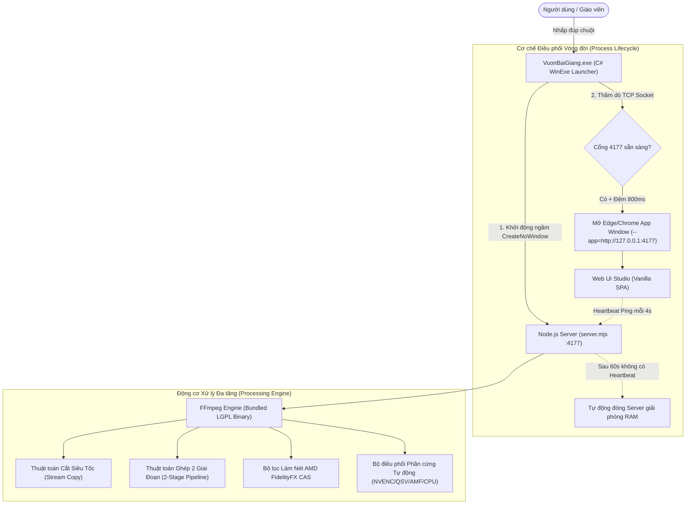

# TÀI LIỆU TỔNG QUAN KỸ THUẬT DỰ ÁN VƯỜN BÀI GIẢNG 2.0
> **Mục đích tài liệu:** Cung cấp bức tranh toàn cảnh về kiến trúc, thuật toán, công nghệ và các vấn đề kỹ thuật chuyên sâu để chuyên gia / AI cố vấn (DeepSeek) phân tích, đánh giá và đề xuất hướng tối ưu hóa tiếp theo.

---

## 1. TỔNG QUAN DỰ ÁN & BỐI CẢNH (PROJECT CONTEXT)

* **Tên dự án:** Vườn Bài Giảng 2.0 — AI Video Studio & Lesson Builder
* **Đối tượng người dùng chính:** Giáo viên tiểu học, THCS, giảng viên và người làm nội dung giáo dục.
* **Yêu cầu phần cứng thực tế:** 
  - Phần lớn người dùng sử dụng **laptop văn phòng thông thường** (Intel Core i3/i5 thế hệ 8 trở lên, RAM 8GB, card đồ họa tích hợp Intel UHD/Iris Xe, không có GPU rời).
  - Một số ít máy của kỹ thuật viên/người dựng chuyên nghiệp có GPU rời (NVIDIA RTX 3060/4060).
* **Mục tiêu cốt lõi:**
  1. **100% Cục bộ & Riêng tư (Local-First):** Không tải video hay bài giảng lên đám mây; xử lý trực tiếp trên phần cứng máy tính người dùng.
  2. **Trải nghiệm ứng dụng Desktop độc lập (Native App UX):** Không yêu cầu giáo viên cài môi trường lập trình (Node.js, Python, FFmpeg), không bắt mở trình duyệt gõ địa chỉ localhost. Mở app qua file `.exe` như một phần mềm độc lập.
  3. **Tốc độ xử lý video cực đại (Near-Instantaneous Processing):** 
     - Cắt phân đoạn video dài 40–60 phút phải hoàn tất trong **< 1 giây**.
     - Ghép chuỗi 20–80 clip bài giảng phải hoàn tất trong **2–5 giây**.
  4. **Nâng cao chất lượng hiển thị chữ viết:** Bài giảng chứa nhiều slide PowerPoint, bảng chữ, công thức toán nên các thuật toán làm nét (sharpening) phải làm rõ chữ mà không gây vỡ nét (aliasing/ringing).

---

## 2. KIẾN TRÚC HỆ THỐNG (SYSTEM ARCHITECTURE)

### Thành phần chi tiết:
1. **Frontend:** Single Page Application (SPA) viết bằng Vanilla HTML5/CSS3/ES6, không dùng framework nặng (React/Vue) để giảm thiểu tiêu thụ RAM trên laptop văn phòng. Tích hợp Canvas Waveform Preview, hệ thống thanh dòng thời gian (Timeline) đa phân đoạn, và Server-Sent Events (SSE) hiển thị tiến trình render thời gian thực.
2. **Backend:** Node.js (bản Portable đóng gói sẵn trong `runtime/node.exe`), kiến trúc hướng sự kiện, hỗ trợ chuẩn **HTTP 206 Partial Content (Range Requests)** giúp phát và tua video MP4 mượt mà không cần nạp toàn bộ file vào RAM.
3. **App Launcher:** Viết bằng C# (.NET 4.0 `csc.exe` mặc định có sẵn trên mọi bản Windows 10/11), biên dịch cờ `/target:winexe`. Đảm bảo không tạo bất kỳ cửa sổ console dòng lệnh màu đen nào khi khởi chạy.

---

## 3. CÁC THUẬT TOÁN & KỸ THUẬT ĐẶC TRƯNG ĐANG ÁP DỤNG

### 3.1. Thuật toán Cắt Phân Đoạn Siêu Tốc (Lossless Stream Copy at Container Level)
* **Vấn đề giải quyết:** Giáo viên thường xuyên quay video màn hình bài giảng dài 40–60 phút (dung lượng 500MB – 2GB), nếu cắt bằng phương pháp re-encode truyền thống thì CPU laptop văn phòng mất 10–20 phút và làm giảm chất lượng hình ảnh.
* **Nguyên lý thuật toán:**
  - Định vị khung hình chính (I-frame / Keyframe) bằng cơ chế input seeking `-ss` và `-to` đặt **trước** `-i`.
  - Sao chép nguyên vẹn luồng dữ liệu container codec: `-c copy -avoid_negative_ts make_zero -movflags +faststart`.
  - **Hiệu năng đạt được:** Cắt video bài giảng **38 – 46 phút (700 MB) chỉ mất 128ms đến 960ms** (gần như tức thì), giữ nguyên 100% bitstream gốc và không sinh nhiệt CPU.

---

### 3.2. Thuật toán Ghép 2 Giai Đoạn Tối Ưu Cho Laptop (2-Stage Concat Pipeline)
* **Vấn đề giải quyết:** Khi ghép 10 đến 80 clip bài giảng nhỏ kèm yêu cầu làm nét hình ảnh / đổi độ phân giải:
  - *Cách tiếp cận cũ (Monolithic Filtergraph):* Truyền 80 tham số `-i` vào FFmpeg và tạo chuỗi `[0:v][1:v]...concat=n=80`. Việc này ép hệ điều hành mở đồng thời 80 bộ giải mã (decoders) trong bộ nhớ, làm tràn RAM, CPU laptop văn phòng bị nghẽn (0.05x speed) hoặc bị watchdog timeout tắt ngang.
* **Giải pháp kiến trúc 2 Giai đoạn:**
  - **Giai đoạn 1 (Demuxer Concatenation):** Tự động sinh tệp chỉ mục `list.txt` ghi rõ đường dẫn từng clip kèm `inpoint` và `outpoint` nếu clip đã bị tỉa. Dùng `-f concat -safe 0 -c copy` để nối thành một file trung gian duy nhất. Giai đoạn này chỉ mất **2 – 4 giây cho 20 – 80 clip**.
  - **Giai đoạn 2 (Single-Stream Quality Enhancement):** FFmpeg chỉ mở **đúng 1 file trung gian** duy nhất để áp bộ lọc scale, AMD CAS sharpen và nén lại. Giúp CPU laptop chỉ phải duy trì 1 decoder và 1 encoder, tốc độ tăng gấp 10 lần và không bao giờ bị nghẽn RAM.

---

### 3.3. Thuật toán Làm Nét Chữ Bài Giảng (AMD FidelityFX CAS - Contrast Adaptive Sharpening)
* **Vấn đề giải quyết:** Các thuật toán làm nét cổ điển như `unsharp` thường làm tăng nhiễu hạt (noise) và tạo viền đen/trắng giả tạo (halo/ringing artifacts) xung quanh chữ viết trong slide PowerPoint.
* **Giải pháp:** Tích hợp bộ lọc thích ứng tương phản **AMD FidelityFX CAS** thông qua FFmpeg:
  $$\text{Filter: } \texttt{cas=strength=0.45}\dots\texttt{0.55}$$
  - Thuật toán tự động nhận diện vùng chi tiết chữ và biên cạnh slide để tăng độ tương phản cục bộ, trong khi giữ nguyên vùng nền phẳng (tránh làm vỡ hạt nền slide).

---

### 3.4. Bộ Điều Phối Phần Cứng Tự Động (Hardware-Adaptive Encoding Engine)
* Hệ thống tự động kiểm tra phần cứng khả dụng theo độ ưu tiên:
  1. **NVIDIA GPU:** Kích hoạt `h264_nvenc` (preset `p2`, tune `ll`, `-cq 20`, bitrate cap phù hợp 1080p/2K/4K).
  2. **Intel iGPU (Laptop văn phòng phổ biến):** Tự động chuyển sang **Intel QuickSync Video (`h264_qsv`)** với `-preset veryfast`, giảm tải cho CPU chính.
  3. **AMD iGPU:** Kích hoạt `h264_amf`.
  4. **CPU thuần (Máy đời cũ):** Ép đa luồng toàn diện `libx264 -preset veryfast -crf 20 -threads 0`.

---

### 3.5. Thuật toán Lọc Khoảng Lặng Tự Động (Auto Silence Detection & Jump-Cut)
* Dùng bộ lọc âm thanh:
  $$\texttt{silencedetect=noise=-30dB:d=0.6}$$
* Phân tích các mốc thời gian im lặng khi giáo viên dừng suy nghĩ hoặc chuẩn bị trang bài, tính toán lại danh sách các khoảng cần giữ lại (keep segments) và tự động cắt bỏ phần chết, lồng hiệu ứng audio fade mịn ở các mối nối để tránh tiếng lách cách (audio click/pop).

---

### 3.6. Thuật toán Quét Điểm Lật Trang Slide PowerPoint (Scene Detection 100x Realtime)
* Để giáo viên không phải tua tìm từng đoạn đổi slide:
  - Video được downscale tạm thời xuống độ phân giải siêu nhỏ: `scale=320:-1`.
  - Áp dụng bộ lọc vi sai khung hình: `select='gt(scene,0.3)',metadata=print`.
  - Tốc độ quét đạt **50x – 100x thời gian thực** (video 30 phút quét xong trong 15–20 giây).

---

## 4. BẢNG THÔNG SỐ HIỆU NĂNG THỰC TẾ ĐÃ ĐO ĐẠC

| Tác vụ | Quy mô dữ liệu | Thời gian thực thi | Trạng thái CPU/GPU | Chế độ |
| :--- | :--- | :--- | :--- | :--- |
| **Cắt phân đoạn 1** | Video 46 phút (704 MB) | **128 ms (0.12s)** | CPU < 2%, RAM không đổi | Lossless Stream Copy |
| **Cắt phân đoạn 2** | Video 38 phút (580 MB) | **962 ms (0.96s)** | CPU < 2%, RAM không đổi | Lossless Stream Copy |
| **Ghép chuỗi 17 clip** | Tổng thời lượng 38 phút | **3.55 giây** | Tận dụng I/O SSD | Fast Stream Copy |
| **Ghép chuỗi 21 clip** | Tổng thời lượng 46 phút | **4.49 giây** | Tận dụng I/O SSD | Fast Stream Copy |
| **Ghép & Nâng nét CAS** | 2 clip Full HD | **5.35 giây** | GPU NVENC / CPU đa luồng | 2-Stage Pipeline |

---

## 5. CÁC VẤN ĐỀ CẦN DEEPSEEK CỐ VẤN & TỐI ƯU HÓA TIẾP THEO

Nhờ DeepSeek xem xét kiến trúc trên và đưa ra đánh giá, giải pháp cho các câu hỏi sau:

1. **Vấn đề Keyframe Mismatch khi Lossless Cut:**
   - Khi cắt bằng Stream Copy (`-c copy`), điểm bắt đầu thực tế của video phụ thuộc vào vị trí I-frame gần nhất (thường cách nhau 1–2 giây tùy phần mềm quay màn hình OBS/Zoom).
   - *Câu hỏi cố vấn:* Có kỹ thuật **Smart Rendering / Smart Cut (Smart Re-encode)** nào khả thi trong FFmpeg để chỉ re-encode vài khung hình từ điểm cắt đến I-frame đầu tiên (GOP đầu), còn toàn bộ phần thân video vẫn giữ Stream Copy không? Cách triển khai tối ưu trên Node.js như thế nào?

2. **Tối ưu hóa hơn nữa thuật toán Concat Demuxer cho các nguồn clip lệch codec/samplerate:**
   - Khi ghép nhiều clip từ các nguồn khác nhau (ví dụ: clip quay bằng điện thoại 44.1kHz và clip quay bằng PowerPoint 48kHz, hoặc lệch fps 29.97 vs 30):
   - Stream Copy có thể gây hiện tượng lệch tiếng (audio desync) ở các clip phía sau.
   - *Câu hỏi cố vấn:* Làm sao để tự động phát hiện trước sự lệch chuẩn này siêu nhanh (chỉ đọc metadata) và quyết định thông minh khi nào được phép dùng Stream Copy, khi nào bắt buộc chuẩn hóa audio samplerate?

3. **Cải tiến thuật toán AI / Thuật toán làm nét bài giảng cho Laptop yếu:**
   - Bộ lọc `cas` hiện tại chạy trên CPU chiếm khoảng 15–25% CPU laptop văn phòng khi re-encode.
   - *Câu hỏi cố vấn:* Có bộ lọc làm nét nào khác trong FFmpeg hoặc shader nhẹ hơn mà vẫn giữ được độ sắc cạnh của chữ nét thanh nét đậm của giáo viên tiểu học không?

4. **Đóng gói phân phối (Packaging):**
   - Hiện tại ứng dụng nặng 201 MB (do chứa `node.exe` 92MB và `ffmpeg.exe` 227MB). 
   - *Câu hỏi cố vấn:* Có giải pháp nào nén gọn hơn (ví dụ strip bỏ các thành phần ffmpeg không dùng, hoặc dùng build FFmpeg tùy chỉnh tối giản cho video giáo dục) để giảm bộ cài xuống dưới 100 MB mà không làm mất tính tương thích?
